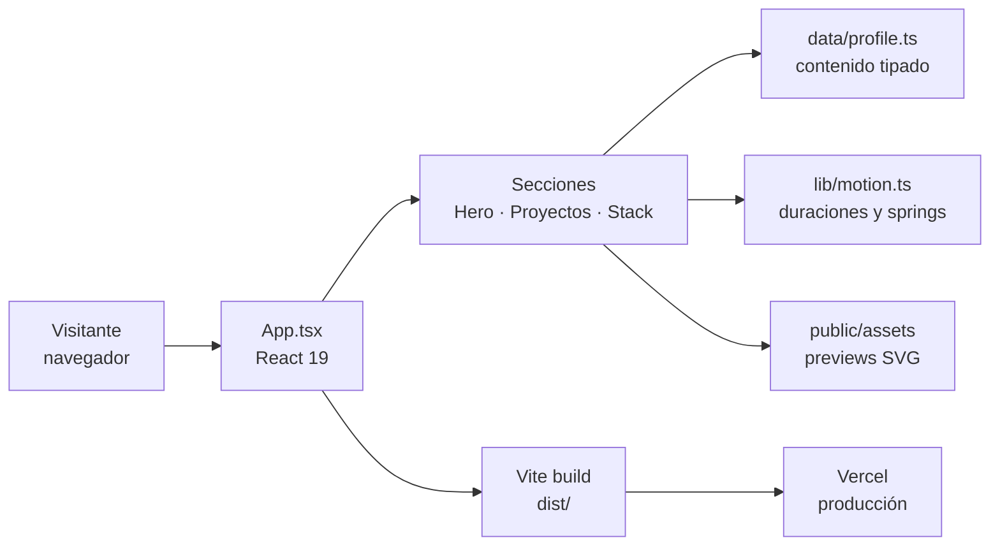

# Arquitectura · System Portfolio

Diagrama interactivo: [`docs/arquitectura.html`](arquitectura.html) — ábrelo en el navegador
(zoom, resaltado de rutas, tema claro/oscuro y export a imagen).

## Vista general



## Componentes

| Componente | Tipo | Qué hace |
|---|---|---|
| **Visitante** | Externo | navegador |
| **App.tsx** | Frontend | React 19 |
| **Secciones** | Frontend | Hero · Proyectos · Stack |
| **Vite build** | Infra / cloud | dist/ |
| **lib/motion.ts** | Frontend | duraciones y springs |
| **data/profile.ts** | Backend | contenido tipado |
| **public/assets** | Datos | previews SVG |
| **Vercel** | Infra / cloud | producción |

## Notas

### Rendimiento
- CLS medido: 0.013
- Solo transform y opacity
- reduced motion respetado

### Calidad
- 11 tests unitarios y 11 E2E
- oxlint y tsc en CI
- Deploy automático con Vercel

## Cómo regenerar el diagrama

El HTML se genera con [Archify](https://github.com/tt-a1i/archify) a partir de un JSON
tipado; el Mermaid de arriba es el mismo grafo en texto.

```bash
# desde una copia de archify
node archify/bin/archify.mjs validate architecture arquitectura.json --json
node archify/bin/archify.mjs render  architecture arquitectura.json docs/arquitectura.html --quality standard
```
